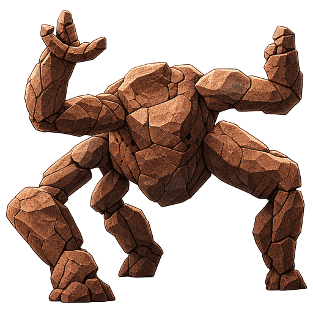
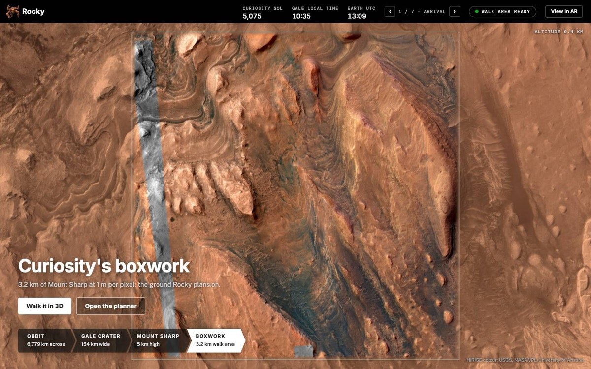
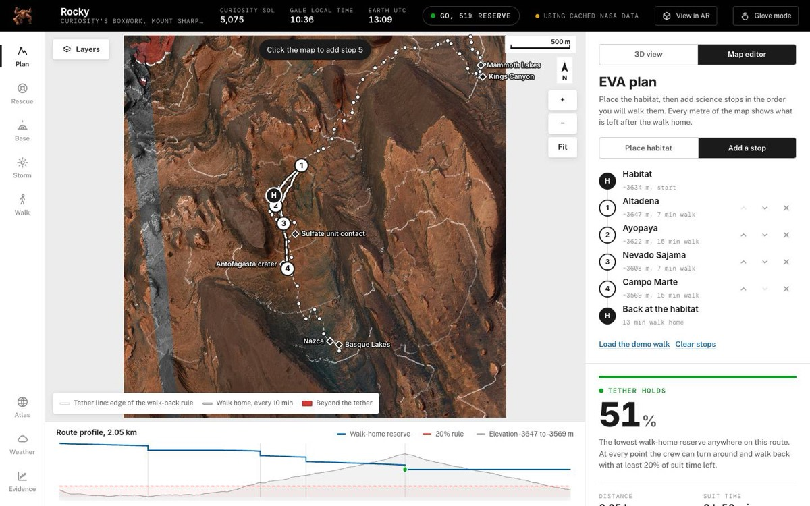
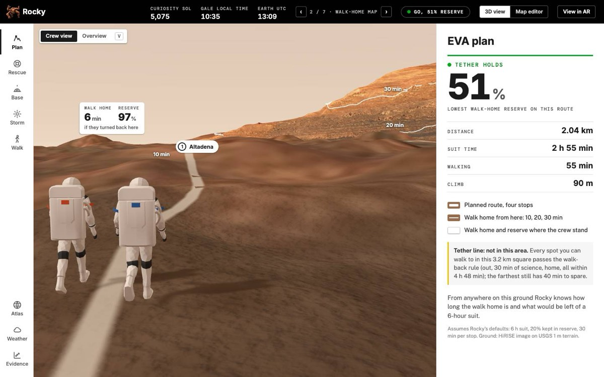
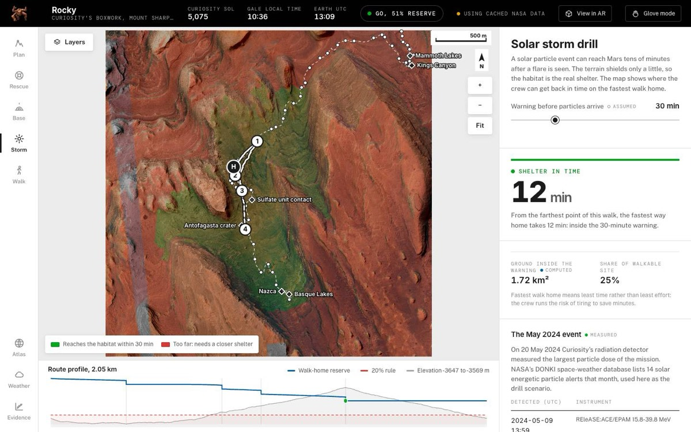
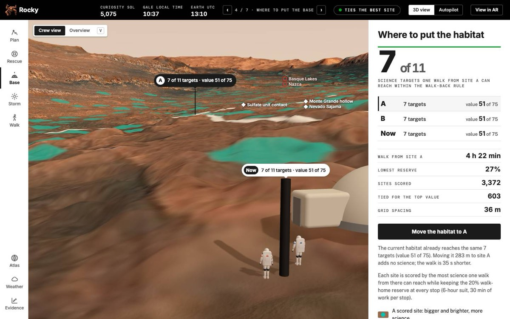
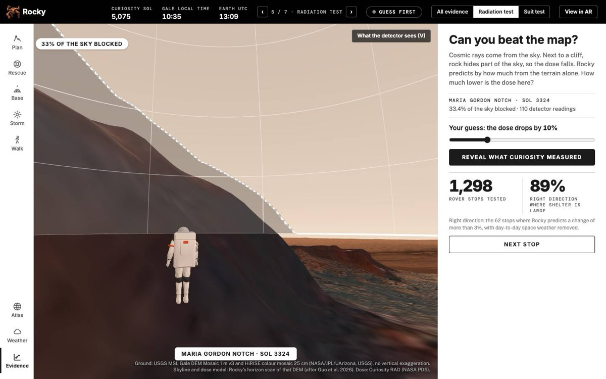
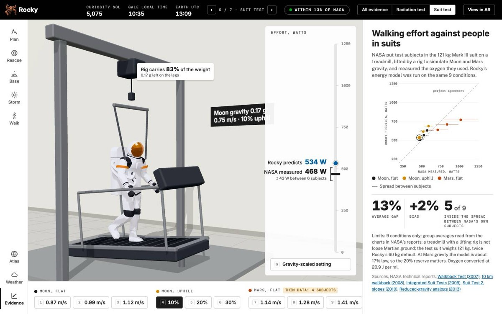

<p align="center">
  
</p>

<h1 align="center">Rocky</h1>

<p align="center">
  <b>Plan a walk on Mars that always keeps a safe way home.</b><br>
  NASA Space Apps Challenge 2026 · <i>Interplanetary Survival Guide: Martian Map</i>
</p>

<p align="center">
  
  
  
  
  
  
</p>

<p align="center">
  
</p>

---

## The question

> *You are 2 km from your habitat on Mars, carrying rock samples, with 90 minutes of suit left. Can you get home?*

Today's Mars maps show **what the ground looks like**. None of them tells a suited astronaut **whether they can still get back from where they stand**.

On the Moon, Apollo crews followed a **walk-back rule**: always be able to walk home on what's left in the backpack (Bellcomm, 1970). It was a single distance on a checklist. **Rocky turns that rule into a map of Mars, for every point.** We checked the map against real data from the Curiosity rover.

The place is real: Curiosity's **boxwork** region on Mount Sharp, in Gale crater. It's a 3.2 km square built from NASA and USGS data at 1 m resolution, and the example the challenge itself gives.

---

## What it does

| | Feature | What it answers |
|---|---|---|
| 🗺 | **Walk-home map** | For every 3 m square: how much suit time is left after walking home from here? |
| 🧭 | **Autopilot** | Which science targets, in what order, give the most science while the rule holds at every step? |
| 🏠 | **Base siting** | Where should the habitat go so one safe walk reaches the most science? |
| ☀️ | **Solar storm drill** | When a solar storm hits, can the crew reach shelter in time? |
| 🎲 | **Chance of getting home** | How likely is the walk to succeed, given that real people vary? |
| ☢️ | **Radiation shelter** | How much does the terrain cut the cosmic-ray dose, checked against Curiosity's detector? |
| 🧪 | **Evidence** | Where every number comes from, and how well each model matches NASA measurements |

<table>
<tr>
<td width="50%"><br><sub><b>Plan.</b> White dotted line: Curiosity's real path. Solid white: our route. The route profile shows the reserve never drops below the 20% rule.</sub></td>
<td width="50%"><br><sub><b>Walk-home map in 3D.</b> Lines on the ground are 10, 20 and 30 minutes from the habitat. "Tether holds 51%" is the worst reserve on the whole walk.</sub></td>
</tr>
<tr>
<td><br><sub><b>Storm drill.</b> Green: you can reach the habitat before the particles arrive.</sub></td>
<td><br><sub><b>Base siting.</b> 3,372 candidate spots scored by how much science one safe walk reaches.</sub></td>
</tr>
<tr>
<td><br><sub><b>Radiation test.</b> Maria Gordon Notch, where Curiosity really parked: guess the dose drop, then see what Curiosity measured.</sub></td>
<td><br><sub><b>Suit test.</b> Our walking model against NASA's suited treadmill measurements.</sub></td>
</tr>
</table>

---

## How it works

### 1. One engine: the walk home from every square
- The terrain is a grid of **1066 × 1066 squares, 3 m each** (about 1.1 million), built from the **USGS 1 m elevation model of Gale crater**.
- Moving between neighbouring squares costs **time and energy**:
  - **Speed** depends on slope (Marquez 2008).
  - **Energy** depends on slope, speed, carried mass and Mars gravity, 3.71 m/s² (Santee 2001).
  - Both equations come from NASA/MIT's **Pextant** planner.
  - Ground steeper than 20° is impassable, NASA's Artemis suit design slope.
- **Dijkstra's algorithm**, run once backwards from the habitat in a Web Worker, gives every square its walk-home time. Checking any route is then just reading values along it:

```
reserve at a point = (suit time − time already spent − walk-home time from here) ÷ suit time
```

A route passes only if the reserve stays **≥ 20% at every square** (6 h suit, 30 min of work per stop; all adjustable).

### 2. Questions asked of that engine
- **Autopilot:** the *orienteering problem*, solved **exactly** with Held–Karp dynamic programming over all **2,048** subsets of the 11 targets. The winner is re-walked square by square to prove the rule holds.
- **Base siting:** the same optimiser on **3,372** candidate sites (36 m spacing, slope under 10°), using two precomputed Dijkstra fields per target.
- **Storm drill:** the **fastest** walk home (least time, not least effort), compared with the warning time.
- **Chance of getting home:** a **Monte Carlo** of 10,000 walks with person-to-person variation in pace and effort, detours and task overruns.
- **Radiation shelter:** a 360° **horizon scan** out to 20 km, accounting for Mars's curvature, gives the share of the sky blocked by terrain (after Guo et al. 2026). The dose is scaled from Curiosity's measured 0.64 mSv per sol.

---

## Why you can trust it

| Check | Result |
|---|---|
| Sky blocked by terrain vs **Guo et al. 2026** (JGR Planets), 15 Curiosity sites | **r = 0.993**, mean difference under 1 point |
| Predicted vs measured dose change, **Curiosity RAD**, 1,298 stops | right direction **89%** where shelter is large; real change ≈ **0.59×** predicted, so the app also shows the detector-corrected value |
| Walking energy vs **NASA suited treadmill tests** (5 reports, 9 conditions, 121 kg suit) | **13%** average gap, bias **+2%**; about 17% low at Mars gravity, which the 20% reserve covers |
| Dijkstra vs brute-force Bellman–Ford, autopilot vs exhaustive search, Mars clock vs Allison & McEwen 2000 | exact match |

**74 automated checks** re-run every claim:

```bash
npx esbuild verify/verify.ts --bundle --platform=node --outfile=/tmp/verify.cjs \
  --define:import.meta.env.BASE_URL='"/"' && node /tmp/verify.cjs
```

Every number in the app is tagged **measured** (by an instrument), **computed** (by Rocky from measured data) or **assumed** (a setting you can change). The limits are stated in the app, under Evidence.

---

## Run it

Requires Node 20+.

```bash
npm install
npm run dev          # http://localhost:5173
```

`npm run dev` and `npm run build` first copy CesiumJS's assets into `public/cesium/`. Everything runs in the browser: there is no backend, no login and no API key. NASA live feeds (REMS weather, Curiosity's position) fall back to cached copies when offline.

| Address | Screen |
|---|---|
| `/#1` … `/#7` | 3D story: arrival, walk-home map, crew down, base, radiation test, suit test, Mars in the room |
| `/#/dashboard?view=plan` | Planner: `plan`, `autopilot`, `storm`, `walk`, `atlas`, `conditions`, `evidence` |
| `/ar.html` | Phone AR: Mount Sharp in your room (Android WebXR, iPhone AR Quick Look) |

**Also in the app**, as visual and demo tools:
- the first-person helmet walk with voice alerts
- the crew-down rescue drill
- the turn-back advisor
- the sand detection layer
- the CAPCOM voice assistant (an in-browser language model; Chrome or Edge, 0.9 GB downloaded on demand)
- depth-estimated 3D rover photos
- AR

---

## Project layout

```
src/
  planner/     walk-home fields (Dijkstra), physics, autopilot, siting, risk, summary
  components/  planner screens (Plan, Autopilot, Storm, Walk, Atlas, Weather, Evidence)
  scenes/      the 7-scene 3D story (Three.js)
  globe/       CesiumJS Mars globe
  game/        first-person walk, bridged to the planner
  ai/          CAPCOM assistant
  ar/ room/    AR model export and the phone AR page
public/data/   terrain, imagery, Curiosity waypoints and photos, validation data
pipeline/      Python and TS scripts that download NASA data and compute the maps
verify/        the test suite
docs/          presentation brief, sources, screenshots
```

---

## Data

All data is real NASA or partner data; nothing is invented.

| Data | Source |
|---|---|
| 1 m elevation model of Gale | USGS Astrogeology (from HiRISE stereo) |
| 25 cm colour imagery | HiRISE, Mars Reconnaissance Orbiter (NASA/JPL/University of Arizona) |
| Context imagery and global maps | CTX, Viking MDIM, MOLA, THEMIS, via NASA Mars Trek |
| Curiosity route, waypoints and photos | NASA/JPL MSL location map, Navcam and Mastcam raw images |
| Radiation | Curiosity RAD (NASA PDS); Hassler et al. 2014; Guo et al. 2026 |
| Weather | REMS (NASA/JPL, Centro de Astrobiología) |
| Space weather | NASA CCMC DONKI |
| Place names | IAU / USGS Gazetteer of Planetary Nomenclature |

Full bibliography with DOIs: [`docs/SOURCES.md`](docs/SOURCES.md) · Assumptions and their backing: [`docs/ASSUMPTION_SOURCES.md`](docs/ASSUMPTION_SOURCES.md)

---

## Credits

- **TETHER** planning engine, radiation validation, autopilot, siting, chance of getting home, turn-back advisor, sand AI, CAPCOM and phone AR: [GharsallahDev](https://github.com/GharsallahDev)
- **3D story scenes**, crew-down drill, suit test and the 1,298-stop radiation check: Chedly
- **Marswalk prototype** (THEMIS sand and rock, Mars clock, atlas, first-person walk) and Rocky's integration and design: [OuhabYouceff](https://github.com/OuhabYouceff)
- Built with help from Claude (Anthropic) for code, research and drafting; disclosed in the app.
- Logo: AI-generated image.
- Astronaut model by J-Toastie (CC-BY 3.0), see [`public/models/CREDITS.md`](public/models/CREDITS.md).

<sub>Not affiliated with or endorsed by NASA. Imagery: NASA/JPL/University of Arizona, NASA/JPL/MSSS, USGS.</sub>
